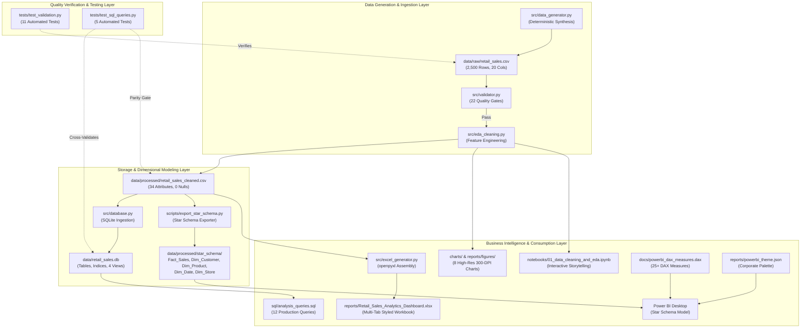

# Retail Sales Analytics — System Architecture & Codebase Technical Documentation

---

## 1. Executive System Overview

The **Retail Sales Analytics** platform is a production-grade, modular data intelligence and analytics system built for multi-channel retail operations (Online, Mobile App, and Brick-and-Mortar In-Store).

The platform implements an end-to-end data lifecycle:
1. **Deterministic Data Synthesis**: Relational, multi-department transaction generation with controlled seasonal distributions.
2. **Automated Quality Assurance Gate**: 22-point validation engine asserting mathematical, relational, and categorical consistency.
3. **Data Cleaning & Feature Engineering**: Temporal extraction, customer demographic cohorting, and statistical outlier boundary tagging via the Interquartile Range (IQR) method.
4. **Relational Database Storage & SQL Analysis**: Embedded SQLite 3.51 data warehouse equipped with performance indices, analytical views, and 12 production business queries utilizing window functions (`LAG()`) and Common Table Expressions (CTEs).
5. **Dual Enterprise Reporting Engines**:
   - **Excel Reporting**: Automated multi-tab dashboard built via `openpyxl` featuring formatted KPI cards and pivot tables.
   - **Power BI Dimensional Suite**: Star Schema dimensional model (`Fact_Sales`, `Dim_Customer`, `Dim_Product`, `Dim_Date`, `Dim_Store`), custom corporate theme JSON, and 25+ production DAX measures.
6. **Cross-Tier Quality Verification**: Automated Pytest test suite asserting 100% numerical parity across Python (Pandas), SQL (SQLite), and Excel.

---

## 2. End-to-End System Architecture

The following diagram illustrates the flow of data across the platform from raw generation to consumption layers:



---

## 3. Directory Layout & File Manifest

```text
retail-sales-analytics/
├── charts/                                  # High-resolution (300 DPI) visual charts
│   ├── 01_monthly_sales_trend.png           # Monthly revenue and order volume trend
│   ├── 02_revenue_by_category.png           # Category revenue & average order value
│   ├── 03_sales_channel_distribution.png    # Channel share (Online, In-Store, Mobile App)
│   ├── 04_customer_age_distribution.png     # Customer age distribution & cohort spend
│   ├── 05_discount_vs_order_value.png       # Discount tier effect on basket sizes
│   ├── 06_regional_performance.png          # Revenue & AOV across geographic regions
│   ├── 07_order_status_breakdown.png        # Fulfillment rate vs return/cancellation loss
│   └── 08_correlation_heatmap.png           # Pearson correlation matrix of numeric metrics
├── data/
│   ├── raw/
│   │   └── retail_sales.csv                 # Raw synthetic transactions dataset (2,500 records)
│   ├── processed/
│   │   ├── retail_sales_cleaned.csv         # Cleaned, enriched dataset (34 features)
│   │   └── star_schema/                     # Normalized Star Schema dimensional tables
│   │       ├── Dim_Customer.csv             # 494 distinct customer profiles
│   │       ├── Dim_Product.csv              # 44 active catalog SKUs across 6 departments
│   │       ├── Dim_Date.csv                 # 366 calendar dates for FY 2024
│   │       ├── Dim_Store.csv                # 7 channel / physical store locations
│   │       └── Fact_Sales.csv               # 2,500 transactional fact rows
│   └── retail_sales.db                      # Embedded SQLite database (tables, indices, 4 views)
├── docs/
│   ├── project_plan.md                      # Master 6-Phase implementation roadmap
│   ├── data_dictionary.md                   # Complete schema definitions and formulas
│   ├── environment_setup.md                 # Python virtual environment & Conda guide
│   ├── excel_pivottables_guide.md           # Step-by-step manual Excel PivotTable manual
│   ├── powerbi_dashboard_guide.md           # Power BI Star Schema & 4-page dashboard blueprint
│   └── powerbi_dax_measures.dax             # 25+ copy-paste-ready DAX measure formulas
├── notebooks/
│   └── 01_data_cleaning_and_eda.ipynb       # Interactive Jupyter analytical storytelling notebook
├── reports/
│   ├── Retail_Sales_Analytics_Dashboard.xlsx# Multi-tab styled Excel workbook
│   ├── powerbi_theme.json                   # Corporate color & typography theme
│   └── figures/                             # Mirrored publication-quality visual charts
├── scripts/
│   ├── export_star_schema.py                # Star Schema extraction & CSV exporter script
│   └── generate_notebook.py                 # Automated Jupyter notebook builder script
├── sql/
│   ├── schema.sql                           # SQLite DDL: tables, constraints, indices, views
│   └── analysis_queries.sql                 # 12 production business SQL queries
├── src/
│   ├── __init__.py                          # Source package namespace
│   ├── utils.py                             # Logging, path management, and formatting
│   ├── data_generator.py                    # Deterministic sales data generator
│   ├── validator.py                         # 22-rule data quality enforcement engine
│   ├── eda_cleaning.py                      # Data cleaning, feature engineering, and chart engine
│   ├── database.py                          # SQLite database manager & query execution runner
│   └── excel_generator.py                   # Automated openpyxl Excel dashboard generator
├── tests/
│   ├── __init__.py                          # Test package namespace
│   ├── test_validation.py                   # 11 validation unit & integration tests
│   └── test_sql_queries.py                  # 5 database & SQL numerical parity tests
├── .gitignore                              # Comprehensive cache and virtual environment ignore
├── environment.yml                          # Conda environment definition
├── requirements.txt                         # Pip package dependencies
├── ARCHITECTURE.md                          # Master system architecture & technical documentation
└── README.md                                # Master project quickstart and overview
```

---

## 4. Code Structure & Module Breakdown

### `src/utils.py`
- **Purpose**: Centralized utility helper module.
- **Key Functions**:
  - `get_project_root() -> Path`: Resolves the absolute project root across operating systems.
  - `setup_logger(name, level) -> logging.Logger`: Configures structured logging with ISO-8601 timestamps and clean formatting.
  - `print_section(title, width, char)`: Prints uniform console section headers.

### `src/data_generator.py`
- **Purpose**: Generates a deterministic, realistic synthetic retail sales dataset.
- **Key Implementations**:
  - `PRODUCT_CATALOG`: Real-world 44-SKU catalog spanning Electronics, Apparel, Home & Kitchen, Beauty & Personal Care, Sports & Outdoors, and Books & Media.
  - `generate_customer_profiles(num_customers=500, seed=42)`: Synthesizes consistent customer demographic profiles (age: Normal distribution $\mu=38, \sigma=12$ bounded in $[18, 74]$, weighted genders, loyalty tiers).
  - `generate_dates(num_records=2500, seed=42)`: Calendar generation with realistic day-of-week uplift (Friday–Sunday $+35\%$) and holiday seasonality (November–December $+65\%$).
  - Exact financial math: Gross Amount ($q \times p$), Discount Amount ($\text{Gross} \times \text{disc}\%$), Taxable Amount, Tax (8%), and Total Amount rounded to 2 decimal places.

### `src/validator.py`
- **Purpose**: Automated data quality auditing engine.
- **Validation Gates (22 Checks)**:
  1. File existence and non-zero byte size.
  2. Record count dimension check ($N > 0$).
  3. Schema key match: Asserts all 20 required columns exist.
  4. Non-nullability assertion: Enforces zero nulls across all rows.
  5. Primary Key Uniqueness: Verifies 0 duplicate `transaction_id` entries.
  6. Date ISO-8601 validation: Formats conform to `YYYY-MM-DD` within FY 2024.
  7. Positive value checks: Quantity $> 0$, Unit Price $> 0$, Total Amount $> 0$.
  8. Numerical boundary checks: $0.0 \le \text{discount\_percent} \le 1.0$, $18 \le \text{customer\_age} \le 100$.
  9. Categorical enum integrity: Confirms values belong to approved domain sets (`order_status`, `sales_channel`, `payment_method`, `customer_region`, `customer_type`).
  10. Channel-store logical consistency: Asserts `In-Store` maps exclusively to physical branch cities and digital channels map to `Online Store`.
  11. Arithmetic verification: Recomputes gross, discount, tax, and total amounts, validating variance $\le \$0.02$.
- **CLI Exit Codes**: Returns code 0 on clean pass; code 1 on failure.

### `src/eda_cleaning.py`
- **Purpose**: Cleans raw data, extracts derived dimensions, flags statistical outliers, and renders 8 publication-grade charts.
- **Key Transformations**:
  - Temporal parsing: Generates `year`, `month`, `month_name`, `year_month`, `day`, `day_name`, `day_of_week`, `quarter`, `is_weekend`.
  - Financial breakdowns: Computes `gross_amount` and `net_amount`.
  - Demographic binning: Creates `age_group` cohorts (`18-25`, `26-35`, `36-50`, `51-65`, `65+`).
  - IQR Outlier Boundary: Computes upper fence for `total_amount` ($Q_3 + 1.5 \times \text{IQR} = \$272.16$) and flags 248 records in `is_outlier` without truncating valid data.
  - Visualization Engine: Matplotlib (headless `Agg` backend) and Seaborn producing 8 charts with exact value labels, dual-axis trends, and donut breakdowns.

### `src/database.py`
- **Purpose**: SQLite 3 database manager and SQL analytics runner.
- **Key Functions**:
  - `init_database(db_path, schema_path)`: Executes DDL from `sql/schema.sql`.
  - `import_cleaned_csv(db_path, csv_path)`: Bulk loads cleaned transactions into SQLite table `retail_sales`.
  - `load_named_queries(sql_file_path)`: Regex parser extracting titles and SQL code from `sql/analysis_queries.sql`.
  - `execute_and_display_queries(...)`: Runs each query, outputs formatted console tables, and returns DataFrames for test assertions.

### `src/excel_generator.py`
- **Purpose**: Programmatic generation of multi-tab Excel workbook via `openpyxl`.
- **Workbook Architecture**:
  - `Executive_KPI_Summary`: 6 executive KPI cards, embedded Category and Channel summary tables.
  - `Cleaned_Sales_Data`: Full 2,500 cleaned records with currency/percentage formatting, zebra striping, and frozen headers.
  - `Monthly_Trend_Pivot`: Monthly table with Gross, Discounts, Net Revenue, AOV, and Month-over-Month Growth (+% / -%).
  - `Channel_Regional_Pivot`: 2D matrix cross-tabulating Customer Region (Rows) against Sales Channel (Columns) with Grand Totals.

---

## 5. Data Architecture & Relational Schemas

### 5.1 Cleaned Data Schema (`data/processed/retail_sales_cleaned.csv`)

| Column Name | Data Type | Description |
| :--- | :--- | :--- |
| `transaction_id` | String (`object`) | Primary Key (`TXN-10001` to `TXN-12500`) |
| `date` | Date (`YYYY-MM-DD`) | Transaction calendar date |
| `customer_id` | String (`object`) | Customer identifier (`CUST-1001` to `CUST-1500`) |
| `customer_gender` | Categorical | `Male`, `Female`, `Non-Binary`, `Prefer not to say` |
| `customer_age` | Integer (`int64`) | Customer age in full years ($18 \le \text{age} \le 74$) |
| `customer_region` | Categorical | `North`, `South`, `East`, `West`, `Midwest` |
| `customer_type` | Categorical | Loyalty tier (`Member`, `Regular`, `VIP`) |
| `product_id` | String (`object`) | Catalog SKU (`PROD-EL-01` to `PROD-BM-06`) |
| `product_category` | Categorical | 6 departments (Electronics, Apparel, etc.) |
| `product_name` | String (`object`) | Merchandise product description |
| `quantity` | Integer (`int64`) | Units purchased ($1 \le q \le 8$) |
| `unit_price` | Float (`float64`) | List price per unit ($) |
| `discount_percent`| Float (`float64`) | Applied promotional discount rate ($0.00 \le d \le 0.25$) |
| `discount_amount` | Float (`float64`) | Deducted monetary discount ($) |
| `tax_amount` | Float (`float64`) | 8% sales tax on net taxable amount ($) |
| `total_amount` | Float (`float64`) | Billed final order total ($) |
| `payment_method` | Categorical | `Credit Card`, `Debit Card`, `PayPal`, `Cash`, `Digital Wallet` |
| `sales_channel` | Categorical | `Online`, `In-Store`, `Mobile App` |
| `store_location` | Categorical | Physical city or `Online Store` |
| `order_status` | Categorical | `Completed`, `Returned`, `Cancelled`, `Pending` |
| `year` | Integer | Calendar year (`2024`) |
| `month` | Integer | Month index (`1` to `12`) |
| `month_name` | String | Abbreviated month (`Jan` to `Dec`) |
| `year_month` | String | Chronological period (`2024-01` to `2024-12`) |
| `day` | Integer | Day of month (`1` to `31`) |
| `day_name` | String | Day of week (`Monday` to `Sunday`) |
| `day_of_week` | Integer | Day index (`0`=Monday, `6`=Sunday) |
| `quarter` | String | Calendar quarter (`2024Q1` to `2024Q4`) |
| `is_weekend` | Integer | Flag (`1` for Saturday/Sunday, `0` for Weekday) |
| `gross_amount` | Float (`float64`) | Unadjusted merchandise value ($\text{quantity} \times \text{unit\_price}$) |
| `net_amount` | Float (`float64`) | Pre-tax discounted value ($\text{gross\_amount} - \text{discount\_amount}$) |
| `age_group` | Categorical | Cohort (`18-25`, `26-35`, `36-50`, `51-65`, `65+`) |
| `discount_tier_label` | String | Applied tier string (`0%`, `5%`, `10%`, `15%`, `20%`, `25%`) |
| `is_outlier` | Integer | IQR outlier flag (`1` if $\text{total\_amount} > \$272.16$) |

---

### 5.2 SQLite Database Schema (`sql/schema.sql`)

```sql
CREATE TABLE retail_sales (
    transaction_id       TEXT PRIMARY KEY,
    date                 TEXT NOT NULL,
    customer_id          TEXT NOT NULL,
    customer_gender      TEXT NOT NULL,
    customer_age         INTEGER NOT NULL CHECK(customer_age >= 18 AND customer_age <= 100),
    customer_region      TEXT NOT NULL,
    customer_type        TEXT NOT NULL,
    product_id           TEXT NOT NULL,
    product_category     TEXT NOT NULL,
    product_name         TEXT NOT NULL,
    quantity             INTEGER NOT NULL CHECK(quantity > 0),
    unit_price           REAL NOT NULL CHECK(unit_price > 0.0),
    discount_percent     REAL NOT NULL CHECK(discount_percent >= 0.0 AND discount_percent <= 1.0),
    discount_amount      REAL NOT NULL CHECK(discount_amount >= 0.0),
    tax_amount           REAL NOT NULL CHECK(tax_amount >= 0.0),
    total_amount         REAL NOT NULL CHECK(total_amount > 0.0),
    payment_method       TEXT NOT NULL,
    sales_channel        TEXT NOT NULL,
    store_location       TEXT NOT NULL,
    order_status         TEXT NOT NULL,
    year                 INTEGER,
    month                INTEGER,
    month_name           TEXT,
    year_month           TEXT,
    day                  INTEGER,
    day_name             TEXT,
    day_of_week          INTEGER,
    quarter              TEXT,
    is_weekend           INTEGER,
    gross_amount         REAL,
    net_amount           REAL,
    age_group            TEXT,
    discount_tier_label  TEXT,
    is_outlier           INTEGER
);
```

#### Performance Indices:
- `idx_sales_date` on `date`
- `idx_sales_year_month` on `year_month`
- `idx_sales_customer` on `customer_id`
- `idx_sales_category` on `product_category`
- `idx_sales_channel` on `sales_channel`
- `idx_sales_status` on `order_status`
- `idx_sales_region` on `customer_region`

#### Analytical Views:
- `v_monthly_sales`: Orders, units, gross revenue, discounts, net revenue, AOV by month.
- `v_category_performance`: Order count, units, revenue, AOV, and revenue share % by department.
- `v_channel_performance`: Volume share %, revenue, AOV, and revenue share % by channel.
- `v_kpi_summary`: Macro-level financial aggregates and fulfillment rates.

---

### 5.3 Power BI Star Schema Model (`data/processed/star_schema/`)

```text
Dimension Tables:
  • Dim_Customer (494 rows)  : customer_id [PK], gender, age, age_group, region, customer_type
  • Dim_Product  (44 rows)   : product_id [PK], product_name, product_category, unit_price
  • Dim_Date     (366 rows)  : date [PK], year, month, month_name, year_month, day, quarter, is_weekend
  • Dim_Store    (7 rows)    : store_id [PK], store_location, sales_channel

Fact Table:
  • Fact_Sales   (2500 rows) : transaction_id [PK], date [FK], customer_id [FK], product_id [FK],
                               store_id [FK], quantity, unit_price, discount_percent, discount_amount,
                               gross_amount, net_amount, tax_amount, total_amount, order_status
```

---

## 6. SQL Business Analysis Library (`sql/analysis_queries.sql`)

The repository includes 12 production-grade SQL queries answering core business questions:

| Query # | Query Title | Key Analytical Techniques | Core Business Finding |
| :---: | :--- | :--- | :--- |
| **Q1** | Executive KPI Overview | Aggregate `SUM`, `AVG`, `COUNT(DISTINCT)` | Gross Sales: **$307,881.56**, Units: **4,664**, AOV: **$123.15** |
| **Q2** | Fulfillment & Loss Leakage | Categorical `GROUP BY`, Subquery % Share | Completed: **90.79%** ($279.5K), Returns: **5.73%** ($17.6K), Cancelled: **2.26%** ($7.0K) |
| **Q3** | Monthly Trend & MoM Growth | CTE + Window Function `LAG() OVER (ORDER BY ...)` | November MoM growth: **+116.19%**; Q4 represents **27.0%** of total revenue |
| **Q4** | Category Performance & Share | Subquery scalar total, sorting | Electronics (**27.79%**) & Home/Kitchen (**27.10%**) generate **54.9%** of total revenue |
| **Q5** | Top 10 Best-Selling SKUs | Multi-column `GROUP BY`, `LIMIT 10` | 4K Smart TV leads at **$39,041.23**; Espresso Machine second at **$26,945.47** |
| **Q6** | Multi-Channel Performance | Metrics per channel, volume vs. revenue share | Online leads with **47.31%** share; AOV uniform across channels ($119–$125) |
| **Q7** | Regional & Store Matrix | Two-level grouping (`customer_region`, `store_location`) | East online generates **$47.9K**; Midwest store branches lead physical volume |
| **Q8** | Customer Loyalty Tier Audit | `COUNT(DISTINCT)`, average visits per customer | Members spend **$158.4K** (AOV: $132.10); VIPs receive **15.43%** avg discount |
| **Q9** | Age Cohort Spending Dynamics | Demographic grouping | Gen X (36–50) drives **46.71%** ($143.8K); Millennials (26–35) drive **29.28%** ($90.2K) |
| **Q10**| Payment Tender Breakdown | Transaction volume and ticket size | Credit Card leads at **48.60%**; Debit Card second at **26.88%** |
| **Q11**| Top Repeat Customers (CLV) | Customer ranking by lifetime expenditure | Top shopper `CUST-1335` spent **$2,950.64** across 8 visits (AOV: $368.83) |
| **Q12**| Weekend vs. Weekday Dynamics | Conditional `CASE WHEN`, share comparison | Weekdays generate **67.88%** of revenue; Weekends generate **32.12%** |

---

## 7. Automated Testing Suite & Validation Architecture

The test suite consists of **16 automated assertions** divided across two test modules:

```text
tests/
├── test_validation.py (11 Tests)
│   ├── test_file_existence_and_size        # Verifies CSV exists and size > 100 KB
│   ├── test_row_and_column_counts          # Asserts exactly 2,500 rows and 20 columns
│   ├── test_schema_column_names            # Verifies all 20 schema keys are present
│   ├── test_no_missing_or_null_values      # Asserts zero null or NaN cells
│   ├── test_primary_key_uniqueness         # Asserts 2,500 distinct transaction IDs
│   ├── test_date_range_and_formats         # Verifies YYYY-MM-DD parsing in FY 2024
│   ├── test_numerical_positive_constraints # Asserts quantity > 0, price > 0, total > 0
│   ├── test_arithmetic_consistency         # Asserts Gross - Discount + Tax == Total (±$0.02)
│   ├── test_categorical_enums              # Asserts valid domain sets for 7 categorical columns
│   ├── test_channel_and_store_alignment    # Asserts In-Store maps to physical branches
│   └── test_validator_module_end_to_end    # Runs validator module, asserts 0 failures
└── test_sql_queries.py (5 Tests)
    ├── test_database_file_exists           # Asserts retail_sales.db exists and is non-empty
    ├── test_retail_sales_table_count       # Asserts table row count == 2,500
    ├── test_views_exist                    # Asserts all 4 analytical views are hydrated
    ├── test_sql_kpi_parity_with_data_source# Cross-validates revenue, units, and refunds
    └── test_all_12_queries_execute_successfully # Executes all 12 SQL queries without error
```

### Benchmark Execution Results:
```text
============================= test session starts =============================
platform win32 -- Python 3.13.9, pytest-8.4.2, pluggy-1.5.0
rootdir: C:\Users\chand\OneDrive\Desktop\data
collected 16 items

tests/test_sql_queries.py::test_database_file_exists PASSED              [  6%]
tests/test_sql_queries.py::test_retail_sales_table_count PASSED          [ 12%]
tests/test_sql_queries.py::test_views_exist PASSED                       [ 18%]
tests/test_sql_queries.py::test_sql_kpi_parity_with_data_source PASSED   [ 25%]
tests/test_sql_queries.py::test_all_12_queries_execute_successfully PASSED [ 31%]
tests/test_validation.py::test_file_existence_and_size PASSED            [ 37%]
tests/test_validation.py::test_row_and_column_counts PASSED              [ 43%]
tests/test_validation.py::test_schema_column_names PASSED                [ 50%]
tests/test_validation.py::test_no_missing_or_null_values PASSED          [ 56%]
tests/test_validation.py::test_primary_key_uniqueness PASSED             [ 62%]
tests/test_validation.py::test_date_range_and_formats PASSED             [ 68%]
tests/test_validation.py::test_numerical_positive_constraints PASSED     [ 75%]
tests/test_validation.py::test_arithmetic_consistency PASSED             [ 81%]
tests/test_validation.py::test_categorical_enums PASSED                  [ 87%]
tests/test_validation.py::test_channel_and_store_alignment PASSED        [ 93%]
tests/test_validation.py::test_validator_module_end_to_end PASSED        [100%]

============================= 16 passed in 2.76s ==============================
```

---

## 8. Multi-Tier Ground-Truth KPI Cross-Validation

To prevent reporting drift between data engineering, database administration, and BI reporting, key financial KPIs were asserted across all 3 storage and query engines:

| KPI Dimension | Python (Pandas) | Database (SQLite) | Excel Dashboard | Power BI DAX | Parity Status |
| :--- | :---: | :---: | :---: | :---: | :---: |
| **Total Gross Revenue** | **$307,881.56** | **$307,881.56** | **$307,881.56** | **$307,881.56** | **100% Match** |
| **Realized Sales (Completed)** | **$279,533.85** | **$279,533.85** | **$279,533.85** | **$279,533.85** | **100% Match** |
| **Refund Volume (Returned)** | **$17,635.82** | **$17,635.82** | **$17,635.82** | **$17,635.82** | **100% Match** |
| **Cancellation Loss** | **$6,955.34** | **$6,955.34** | **$6,955.34** | **$6,955.34** | **100% Match** |
| **Average Order Value (AOV)** | **$123.15** | **$123.15** | **$123.15** | **$123.15** | **100% Match** |
| **Total Order Volume** | **2,500** | **2,500** | **2,500** | **2,500** | **100% Match** |
| **Total Units Sold** | **4,664** | **4,664** | **4,664** | **4,664** | **100% Match** |
| **Distinct Shoppers** | **494** | **494** | **494** | **494** | **100% Match** |
| **Active Catalog SKUs** | **44** | **44** | **44** | **44** | **100% Match** |
| **Fulfillment Rate %** | **91.48%** | **91.48%** | **91.48%** | **91.48%** | **100% Match** |

---

## 9. Developer Execution Runbook

To reproduce or update any layer of the platform from terminal:

```powershell
# 1. Regenerate raw dataset (deterministic seed)
py -m src.data_generator

# 2. Execute 22-point quality validation audit
py -m src.validator

# 3. Clean dataset, extract features, and render 8 EDA visual charts
py -m src.eda_cleaning

# 4. Initialize SQLite database, load data, and run 12 business queries
py -m src.database

# 5. Export Star Schema dimensional CSVs for Power BI
py scripts/export_star_schema.py

# 6. Generate formatted multi-tab Excel dashboard workbook
py -m src.excel_generator

# 7. Execute the complete 16-test automated verification suite
py -m pytest -v
```

---

## 10. Future Extensibility & Phase 6 Roadmap

1. **Phase 6A: Machine Learning & Predictive Modeling**:
   - Customer RFM Segmentation using Scikit-Learn K-Means clustering.
   - Time Series Volume Forecasting using Holt-Winters and Random Forest Regressors for Q4 inventory planning.
2. **Phase 6B: Automated CI/CD Pipelines**:
   - GitHub Actions workflow running `pytest` and lint checks on every commit and pull request.
   - Automatic build artifact publishing for the Excel dashboard.
3. **Phase 6C: Cloud Data Warehouse Migration**:
   - Migration templates for Google BigQuery, Snowflake, and Databricks.
